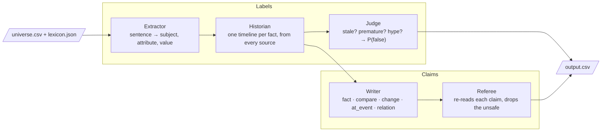

# Hype or Truth Arena · Neural Ninjas

Our entry to QA DNA's **Hype Arena** challenge at the NEXXT AI Hackathon (28–29 October 2026). The original starter README is in [`docs/STARTER_README.md`](docs/STARTER_README.md).

Hooly's pages, posts and press releases contradict each other. Prices change, people join and leave, and some sources simply lie. Our system reads every sentence, rebuilds each fact's timeline from all the sources, and decides what holds on the sentence's date. Then it writes 1,000 new claims that do hold, and checks each one before handing it in.

**No language model runs in the system.** Every verdict comes from parsed values, fact timelines and a small tree model trained on the practice rows, so you can trace each answer back to its evidence.

## How it works



| Agent | What it does | How |
| --- | --- | --- |
| **Extractor** | Turns a sentence into facts | A value parser that follows `contracts/value-forms.md` reads money, counts, dates, versions and durations. Subjects come from the lexicon or, when a sentence doesn't name one, from earlier sentences on the same page. A scorer trained on the practice forms picks the attribute. |
| **Historian** | Builds each fact's timeline | It gathers every sighting of a fact. Labelled rows are trusted anchors and unlabelled rows are votes. A sticky path (Viterbi) through the sightings gives the value held on each date. A single source can't move the timeline, but a run of sources saying the same new thing can. |
| **Judge** | Rules on each sentence | It compares the sentence's value with the timeline and names the failure: *stale* (the value had already moved on), *premature* (it only holds later) or *hype* (no source backs it while others agree on another). A gradient-boosted tree model turns this evidence into P(false), which gives the label and its confidence. Before it calls a sentence false, it checks whether the Extractor could have misread the value. |
| **Writer** | Writes 1,000 new claims | It works only from facts labelled true. It writes changes (A, then later B), facts at events, relations (for example, the CTO's start date), facts as of 29 Oct 2026 and comparisons, and ranks them safest first. |
| **Referee** | Checks every claim before it ships | It re-reads each sentence with the same parser and rejects anything the official referee could misread: a stray number, a second value, a negation, or a name outside the lexicon. It also drops any claim that the full universe's timeline contradicts. |

## Results on the practice data

Labels are hidden fold by fold (out-of-fold cross-validation over 1,897 rows):

| | Accuracy |
| --- | --- |
| Calling everything true (baseline) | 83.3% |
| **Hype or Truth Arena**, with labelled neighbours | **85.5%** |
| **Hype or Truth Arena**, unlabelled votes only | 83.9% |
| The same pipeline with perfect fact extraction (ceiling) | 88.8% |

**Claims back-test.** We write claims from 80% of the practice rows and check them against all the rows, five times over. Of 5,000 claims, **99.2% are confirmed**, 4 are contradicted (each one a fact whose value changed after the last sighting the Writer saw), and the rest can't be checked either way. Run it with `python -m arena.backtest`.

The evaluation universe holds about 20,000 rows, so each fact has ten times more sources, and those sources are what the Historian works from. A run over 19,000 rows takes about 30 seconds on 2 CPUs.

## Run it

**The evaluation run** (what the organisers do):

```sh
scripts/check.sh            # builds the image and runs it offline on the practice data
```

**The frontend** (the architecture diagram, plus live runs on any rows):

```sh
sh start-frontend.sh        # builds the same image and serves http://localhost:8000
```

To run it without Docker, install Python 3.10+, then run `pip install -r requirements.txt` and `python web/server.py`.

The page loads `sample/sample.csv` when the file exists. You can also paste rows or upload any CSV with `id,text,date`. Open a verdict to see the fact's timeline: every source over time, what the Historian believes held, and where the sentence falls.

## Layout

```
arena/values.py       value parser (contracts/value-forms.md)
arena/extract.py      Extractor
arena/verify.py       Historian + rule-level Judge
arena/judge_model.py  Judge features (evidence → P(false))
arena/train.py        build-time training, out-of-fold metrics → models/
arena/claims.py       Writer + Referee
arena/pipeline.py     wiring shared by run.py and the web app
run.py                offline entry point: /universe → /output/output.csv
web/                  React frontend (web/src) and its build (web/dist), served by web/server.py
```

LLMs helped us build this system. The submitted system doesn't use one.
